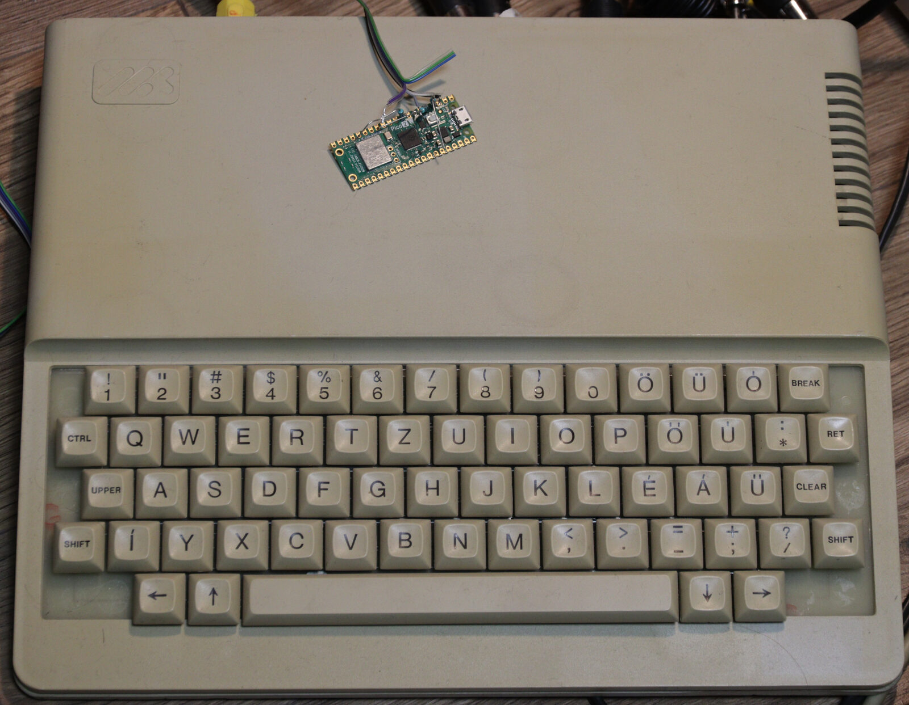
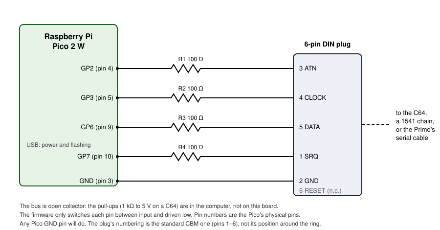
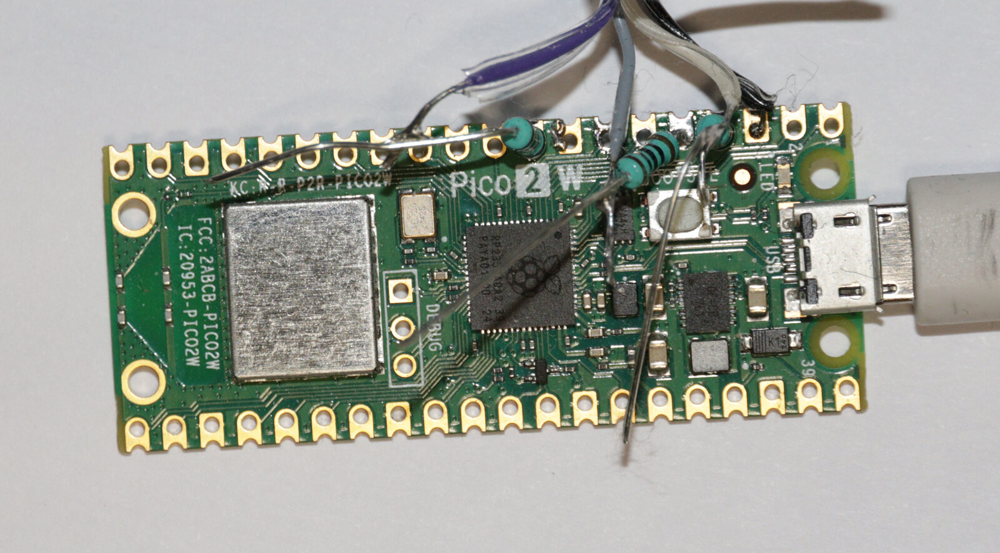
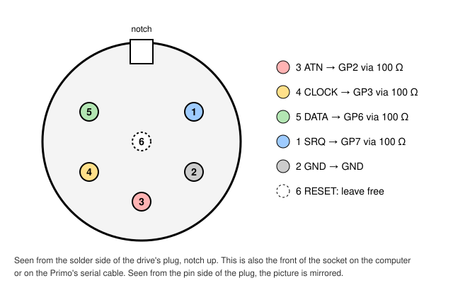

# Hardware

*The drive, a Pico 2 W with its series resistors and bus wires, lying on a
Microkey Primo.*

## What you need

| Part | Notes |
|---|---|
| Raspberry Pi Pico 2 W | RP2350 with the CYW43439 Wi-Fi chip, 4 MB flash. The plain Pico 2 (no W) has no Wi-Fi and is not supported. |
| Four 100 Ω resistors | One in series with each bus line. See below. |
| A 6-pin DIN plug and cable | The Commodore serial bus connector, also used by the Primo's serial port. |
| USB cable | Power and flashing. |

## The bus lines

The drive uses four GPIO pins, each through a 100 Ω resistor:

| Signal | GPIO | Pico pin | Resistor | DIN pin |
|---|---|---|---|---|
| ATN | GP2 | 4 | 100 Ω | 3 |
| CLOCK | GP3 | 5 | 100 Ω | 4 |
| DATA | GP6 | 9 | 100 Ω | 5 |
| SRQ | GP7 | 10 | 100 Ω | 1 |
| GND | GND | 3 (or any GND) | — | 2 |

*The board this project was built and tested on: the resistors are soldered
straight onto the Pico's pads, and the wires go to the DIN plug.*

*The plug's pins from the solder side, notch up. The numbers are not in
order around the ring: pin 6 is in the centre, and 1 to 5 run from upper
right, clockwise, to upper left. The pin side is the mirror image.* Pin
positions from Wikipedia's [Commodore bus][cbmbus] diagram, which shows the
computer's socket from the front: the same view as the plug's solder side.

DIN pin 6 is RESET; the drive does not use it.

The bus is **open collector**: every device only ever pulls a line low, and
pull-up resistors to 5 V make it high. The firmware does the same: it switches
a pin between input and driven low. So the Pico never drives 5 V, but a line
that reads high puts 5 V on its pin.

**This board uses a 100 Ω resistor in series with each line, and no level
shifter.** It works, and every test in this project ran on it, but it is not
the best way. It leans on the RP2350's pins tolerating 5 V:

- Raspberry Pi states that the RP2350's GPIO pins tolerate up to 5.5 V, but
  only while IOVDD is powered at 3.3 V. 5 V on a pin of an unpowered Pico can
  damage the pad. ([RP2350 A4 announcement][a4]; RP2350 datasheet,
  section 14.8.2.1, as quoted on the [Raspberry Pi forum][forum] — *the
  datasheet table itself was not checked*.)
- This applies to GPIO 0–25. The ADC pins, GPIO 26–29, have a diode to IOVDD
  and must not see more than IOVDD + 0.3 V ([Pico 2 datasheet][pico2],
  section 5.2). The drive uses GPIO 2, 3, 6 and 7.
- Raspberry Pi announced official 5 V tolerance with stepping A4. The A4
  change notice ([PCN 28][pcn]) does not mention it, and the RP2350's
  errata were fixed in A3. Pico 2 W boards were made with A2, A3 and A4
  during the change-over. The stepping is printed on the chip: a part number
  ending in `A4` (for example `RP23500A0A4`).
- **Earlier steppings, A2 included, are most likely tolerant too, but
  not officially.** A4 changed only the metal layers and is "a drop-in
  replacement for A2" ([announcement][a4]). A Raspberry Pi engineer wrote
  "I believe 2 is as well - we just spent the time testing and qualifying"
  and "input can go to 5v (as long as the chip is powered), but output is
  still 3v3" ([forum, 2025-08-01][jamesh]); a member of the applications
  team wrote "Earlier steppings of RP2350 are also 5v tolerant"
  ([forum, 2025-08-05][transonic]). The launch datasheet did say
  "5 V-tolerant (powered)", but Raspberry Pi removed the line soon after,
  saying it was left in by mistake ([forum, 2024][t375118]). No datasheet
  or change notice states it for A2, and no bench test of an A2 was found.

**The board this project was built and tested on has an A2 chip,** made
before the official 5 V statement, and not qualified for it. That is why the
resistors are there: they limit the current into a pin if it does not
tolerate 5 V after all. On an A4 board they are still worth keeping, for
the case where the bus is live and the Pico is not powered.

So **power the drive before you connect it to a running computer, and switch
the computer off before you unplug the drive's USB.**

Why 100 Ω: the C64's pull-ups are 1 kΩ, and a series resistor forms a voltage
divider with them when the drive pulls a line low. 1 kΩ in series would leave
about 2.5 V on the bus, which is not a valid low. 100 Ω keeps the low clean
(68–220 Ω works, the lower half is better) and still limits the current.

A proper level shifter (an open-drain buffer or a transistor per line) would
not depend on any of this. It is not what this board has, and it has not
been tested with this firmware.

[cbmbus]: https://en.wikipedia.org/wiki/Commodore_bus
[a4]: https://www.raspberrypi.com/news/rp2350-a4-rp2354-and-a-new-hacking-challenge/
[forum]: https://forums.raspberrypi.com/viewtopic.php?p=2377168
[pico2]: https://datasheets.raspberrypi.com/pico/pico-2-datasheet.pdf
[jamesh]: https://forums.raspberrypi.com/viewtopic.php?p=2329679
[transonic]: https://forums.raspberrypi.com/viewtopic.php?p=2330635
[t375118]: https://forums.raspberrypi.com/viewtopic.php?t=375118
[pcn]: https://pip-assets.raspberrypi.com/categories/1263-pcn/documents/RP-008771-CC/RP235x-A4-stepping-PCN.pdf

## Power

The Pico is powered over USB. Keep it powered from a supply, not from the
computer you use to watch the C64's screen: a capture card and the drive on
the same PC share ground twice, and that ground loop corrupts data silently
(see [troubleshooting](SOFTWARE.md#troubleshooting)).

## The Primo

The Primo's serial port is the same bus, on a 5-pin DIN socket. A
Primo-to-Commodore cable (the one a Primo uses for a 1541) connects it to the
drive's 6-pin plug:

| Primo pin (5-pin DIN) | Signal | Drive's plug (6-pin DIN) |
|---|---|---|
| 2 | ATN | 3 |
| 5 | CLOCK | 4 |
| 3 | DATA | 5 |
| 4 | GND | 2 |
| 1 | — | 1 (SRQ, unused) |
| — | — | 6 (RESET, not wired) |

Source: the cable table in the FDU-1109 manual, appendix D.

An A series Primo has no serial port fitted, and every Primo needs the CDOS
boot EPROM to start from the drive. See
[What your Primo needs](PRIMO.md#what-your-primo-needs). The port's address (0x40 or 0x80) is
read from the machine's ROM by the boot file, so the drive needs no setting
for it. See [The Primo](PRIMO.md).
