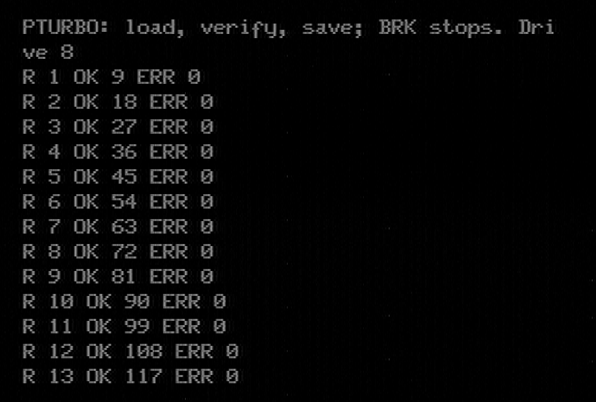

# Test programs

These programs run on the real computer against the real drive. A file that
loads only shows the bus is not badly broken; these tests compare the data
byte by byte and count every failure, so a subtle fault shows up as a number.

Before and after each test, read the drive's counters at `/api/stats` (log
in as admin; see [troubleshooting](SOFTWARE.md#troubleshooting)). In a
healthy run these stay as they were:

| Counter | Meaning |
|---|---|
| `boots` | 1 since power-on. Higher means the drive restarted on its own. |
| `atn_bails` | 0. The drive missed the 1 ms deadline to answer the computer. |
| `pio_bad` | 0. A byte the bus hardware decoded wrongly. |
| `pt_aborted` | 0. A Primo turbo transfer that was given up. |

Switching a C64 off while it is connected raises `boots`. That is expected,
so note the counters before you plug or unplug anything.

Where the programs come from:

| Program | Computer | How to get it onto the drive |
|---|---|---|
| IECTEST, IMGTEST, HUNGTEST | C64 | In the release: `python3 deploy.py --ip <address> --c64-tests` |
| SJLOAD, CRCCHECK | C64 | Third-party, from the SJLOAD disk; not included |
| PTURBO8, PTURBO9 | Primo | From the source: assemble `tools/primo/turbo/pturbo.asm` |

## IECTEST: the drive's basic operations (C64)

**Why:** this is the main check that the drive reads, writes, lists and
deletes files correctly over the bus.

**What it does:** eight steps, in this order:
1. reads the drive's status;
2. writes a small file;
3. reads it back and compares it;
4. writes a big file of numbered lines;
5. reads it back line by line;
6. reads the directory;
7. scratches (deletes) the test files;
8. checks that they are gone.

**How to start:** `LOAD"IECTEST",8`, then `RUN`. A start screen waits 8
seconds; with no key it runs one round on drive 8 with 200 lines. The keys
change that:

| Key | Setting |
|---|---|
| F1 | Drive 8, or 9 (the RAM drive: no flash writes, only the bus) |
| F3 | 200, 1000 or 1800 lines in the big file |
| F5 | Loop until `Q`, with a round counter |
| F7 | Stop at the first failure and keep the files, or count it and go on |
| RETURN | Start now |

**Result:** every step ends in `OK` (or a byte count for DIR), and the last
line reads `ALL TESTS PASSED`. Any other text names the step that failed.
The time it shows comes from the C64's own clock, which stops during bus
transfers, so it reads low.

## IMGTEST: disk images (C64)

**Why:** disk images (D64, D71, D81, DNP) run through a separate part of the
drive. IECTEST does not touch it.

**What it does:** it mounts each image with `CD`. It reads IECTEST back out
of `TESTDISK.D64`. It formats each of the four empty images, then writes,
verifies, lists and scratches a file in it, and unmounts it.

**How to start:** `LOAD"IMGTEST",8`, then `RUN`. It needs the five image
files that `deploy.py --c64-tests` uploads.

**Result:** each image ends in `---> PASS`, and the last line reads
`ALL IMAGE TESTS PASSED`. Formatting the D81 needs about 1.25 MB free on the
drive. With less, the drive answers `72 DISK FULL` and the test reports the
D81 as skipped, not failed: delete some files and run it again.

## HUNGTEST: a C64 that hangs mid-transfer (C64)

**Why:** a C64 that crashes or freezes while the drive is sending used to
make the drive restart itself after 8 seconds. Now the drive waits, keeps
itself alive, and goes on when the computer comes back. This test causes
such a freeze on purpose.

**What it does:** it opens a file and lets the drive send one byte. Then it
never acknowledges that byte, and holds the bus that way for about 20
seconds with interrupts off. Then it sends UNTALK, which ends the drive's
wait.

**How to start:** read `/api/stats` first. Then `LOAD"HUNGTEST",8` and
`RUN`. The screen stays at `HOLDING THE BUS ...` for about 20 seconds; that
is the test.

**Result:** the C64 shows `RELEASED`, `STATUS 0 OK` and `HUNGTEST DONE`. On
the drive, `tx_long_waits` has gone up by 1 and `boots` has not changed. If
`boots` went up, the drive restarted: the test failed.

## CRCCHECK: JiffyDOS loads (C64)

**Why:** JiffyDOS loads have the tightest timing on the bus. A small timing
error damages a few bytes and leaves the rest intact, so a program can load
and still be wrong.

**What it does:** it loads itself again and again over JiffyDOS and checks a
checksum each time.

**How to start:** on a stock C64, first `LOAD"SJLOAD",8` and `RUN`, then
`LOAD"CRCCHECK",8` and `RUN`. It always reloads from drive 8.

**Result:** it reports a checksum error when a load arrives damaged.
Errors have shown up every few to about 50 passes on a clean bench. The cause is still open, so a short
error-free run proves little: run many passes.

## PTURBO: loading and saving on the Primo (Primo)

**Why:** this checks the Primo's fast load and save, the turbo, with every
file size where an error could hide.

**What it does:** each round goes through eight sizes, from 1 byte to 16 KB,
and then the screen. For each one it:
1. saves a file of pseudo-random bytes;
2. loads it back;
3. checks the type, the length and every byte, and that nothing was written
   past the end;
4. verifies the file;
5. flips one byte and verifies again, which must find exactly one
   difference. That proves the verify really compares.

**How to start:** `CMD LOAD"PTURBO8"` (or `"PTURBO9"` for the RAM drive). It
runs round after round; BRK stops it after the current round.

**Result:** one line per round, `R <round> OK <files> ERR <errors>`. `ERR`
must stay 0. An error prints a line before that: a letter for the phase
(S save, L load, T type or length, C compare, V or W verify), the size's
number, and a code. Code 255 means a bus error. On the drive, `pt_aborted`
stays 0.

